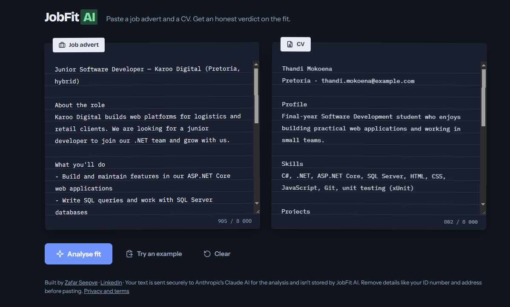
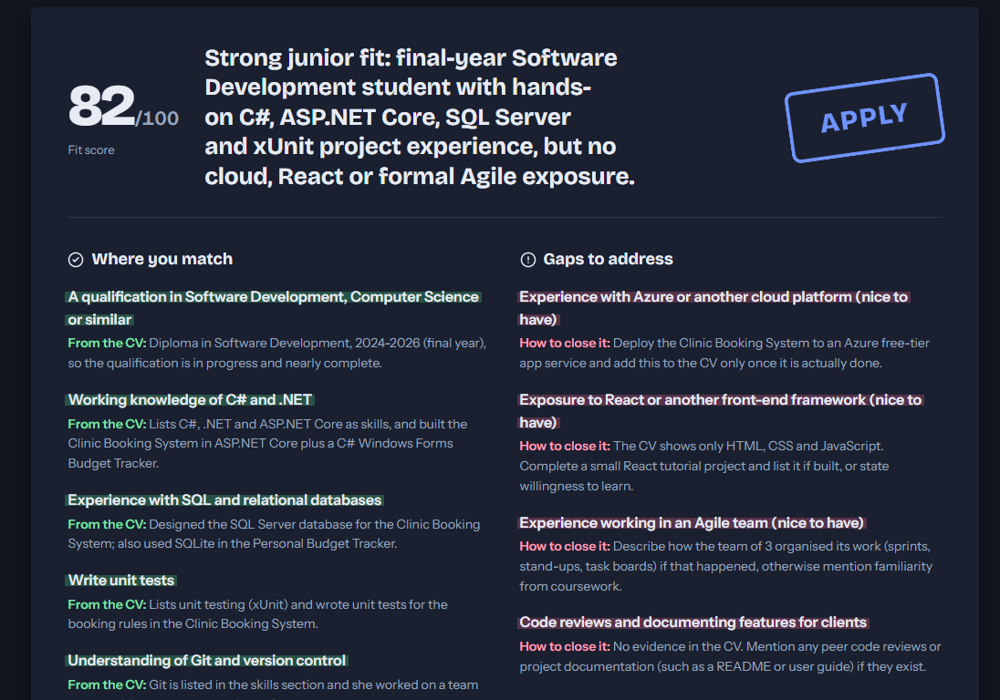
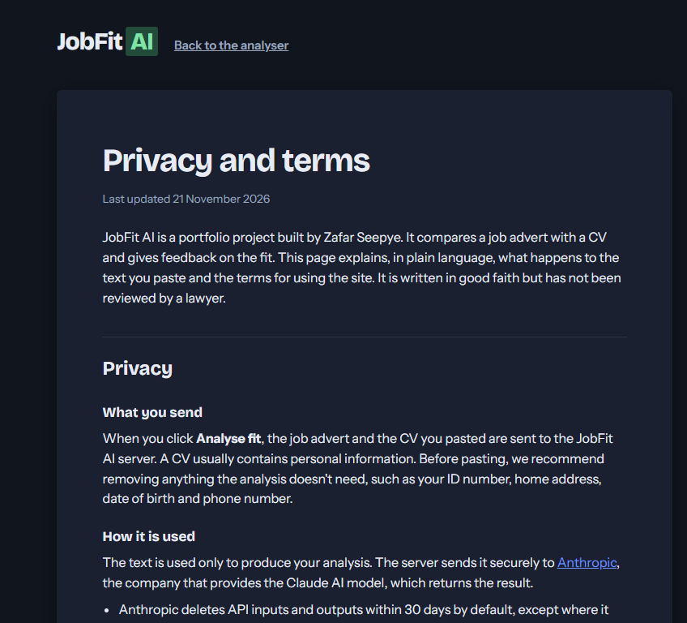
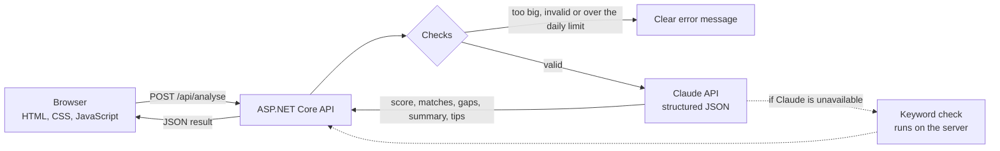

# JobFit AI

[](https://github.com/ZafarSeepye/JobFitAI/actions/workflows/ci.yml)


Paste a job advert and a CV. JobFit AI gives an honest verdict on how well they match.

- A **fit score** out of 100 and a verdict: **Apply**, **Stretch** or **Skip**
- The **requirements you meet**, with the line from the CV that proves each one
- The **gaps**, with a practical way to close each one
- A **CV summary tailored** to that job, and three things to do before applying

I built it because I was doing this comparison by hand for every job I applied for.

**Live demo:** coming soon

## Screenshots

**The two documents, side by side**



**The result: score, verdict stamp, matches and gaps**



**A plain-language privacy and terms page**



## How it works



1. The page sends the job advert and the CV to the app's own API.
2. The API checks the request: size, length and the daily limit.
3. The API sends both documents to Claude with clear instructions and a strict JSON format for the reply.
4. The API checks Claude's reply, works out the verdict from the score, and sends the result back.
5. The page draws the report: the score counts up, the verdict stamp lands, and the matches and gaps are highlighted.

If Claude can't be reached, the app falls back to a simple keyword check, so the user still gets a result. Keyword results are clearly labelled.

## Features

- **AI analysis** with Claude Sonnet 5.5, using structured outputs so every reply has the same shape
- **Honest by design:** Claude is told to use only evidence from the CV and never to invent experience
- **Automatic fallback** to a free keyword check if the AI is unavailable
- **"Try an example"** button with a fictional job advert and CV, so anyone can test it in one click
- **Responsive** design with a dark mode, keyboard support and reduced-motion support

## Security and privacy

- **The API key never reaches the browser or GitHub.** It's kept in .NET user secrets locally and an environment variable in production.
- **Rate limits:** 5 analyses per visitor per day, plus a site-wide daily cap, to protect the API budget
- **Spoof-proof limits:** forwarded IP headers are only trusted when the app runs behind a known proxy
- **Request size limit:** anything over 100 KB is rejected before it's read
- **Server-side validation:** the server re-checks every request, and the score and verdict are always calculated on the server
- **Prompt-injection defence:** the documents are wrapped in tags and treated as data, and Claude is told to ignore any instructions inside them
- **XSS protection:** all text is inserted with `textContent`, backed by a strict Content Security Policy
- **Security headers:** CSP, anti-clickjacking, no MIME sniffing, no referrer, and HSTS in production
- **No stored data:** no database, no accounts, no cookies, no analytics
- **Privacy page** explaining exactly where the text goes, in line with South Africa's POPIA

## Tech stack

| Part | Technology |
|---|---|
| Back end | C#, ASP.NET Core minimal API, .NET 10 |
| AI | Claude API (Messages API, structured outputs) |
| Front end | HTML, CSS, JavaScript, GSAP animations |
| Testing | MSTest, WebApplicationFactory (in-memory API tests) |
| CI | GitHub Actions (build and test on every push), Dependabot |

## Project structure

```
JobFitAI/
├── src/JobFitAI.Web/
│   ├── Program.cs              App start-up, endpoints and middleware
│   ├── Models/                 Request and result shapes, verdict rules
│   ├── Validation/             Server-side input checks
│   ├── Services/               Claude analyser, keyword fallback, prompt and schema
│   ├── Security/               Rate limits and security headers
│   └── wwwroot/                The web page, styles, scripts and privacy page
├── tests/JobFitAI.Tests/       42 unit and integration tests
└── .github/                    CI workflow and Dependabot
```

## Run it locally

You need the [.NET 10 SDK](https://dotnet.microsoft.com/download).

1. Clone the repo:
   ```
   git clone https://github.com/ZafarSeepye/JobFitAI.git
   cd JobFitAI
   ```
2. Optional: add a Claude API key from the [Claude Console](https://platform.claude.com). Without a key, the app runs the keyword check only.
   ```
   cd src/JobFitAI.Web
   dotnet user-secrets set "Claude:ApiKey" "your-key-here"
   ```
3. Start the app from `src/JobFitAI.Web`:
   ```
   dotnet run
   ```
4. Open **http://localhost:5080**

## Run the tests

From the root folder:

```
dotnet test
```

- **42 tests** cover the input rules, the verdict boundaries, the keyword check, reading Claude's reply, the fallback, and the full API (validation, rate limits and security headers).
- Claude is replaced by a fake in the tests, so they're free, fast and work offline. They never use a real API key.

## Configuration

Settings live in `src/JobFitAI.Web/appsettings.json`. The API key is never stored there.

| Setting | Default | What it does |
|---|---|---|
| `Claude:Model` | `claude-sonnet-5-5` | The Claude model used for the analysis |
| `Claude:Effort` | `medium` | How much reasoning Claude uses (affects cost and speed) |
| `RateLimits:PerVisitorPerDay` | `5` | Analyses each visitor can run per day |
| `RateLimits:GlobalPerDay` | `30` | Analyses the whole site can run per day |
| `Hosting:BehindProxy` | `false` | Set to `true` only when hosted behind a trusted proxy |

## Design decisions

- **An interface for the analyser** (`IFitAnalyser`), so Claude, the keyword check and the test fake can be swapped without touching the endpoint
- **The verdict is calculated in code** from the score, so the stamp and the score can never disagree
- **The JSON contract was defined first**, so the front end and back end could be built independently
- **No external CDNs:** the fonts and GSAP are stored in the project

## Credits

- AI analysis by [Claude](https://www.anthropic.com) (Anthropic)
- Animations by [GSAP](https://gsap.com)
- Fonts: Bricolage Grotesque, Instrument Sans and IBM Plex Mono (SIL Open Font License)
- Icons from [Lucide](https://lucide.dev) (ISC License)

## Author

**Zafar Seepye**, Software Engineering student at CTU Training Solutions

[Portfolio](https://zafarseepye.github.io) · [LinkedIn](https://www.linkedin.com/in/zafarseepye) · [GitHub](https://github.com/ZafarSeepye)
